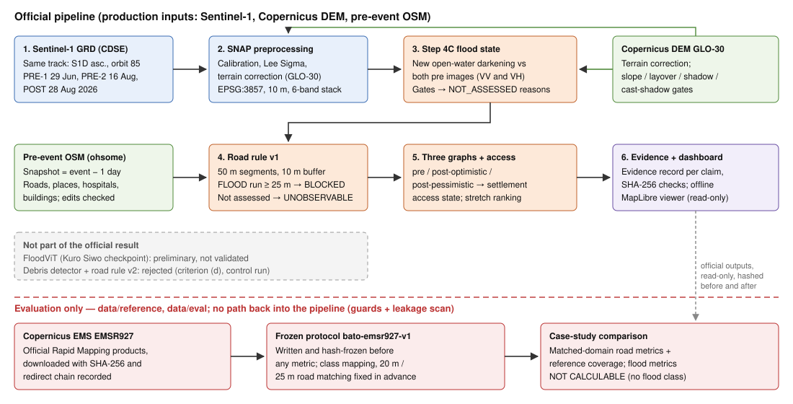
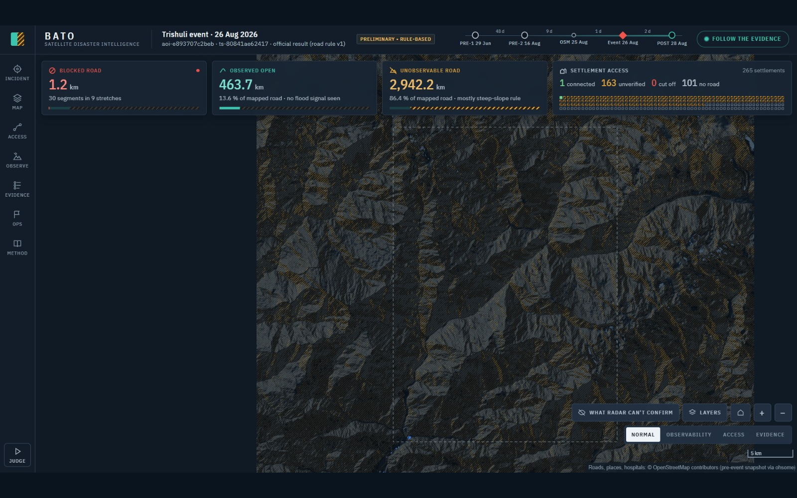
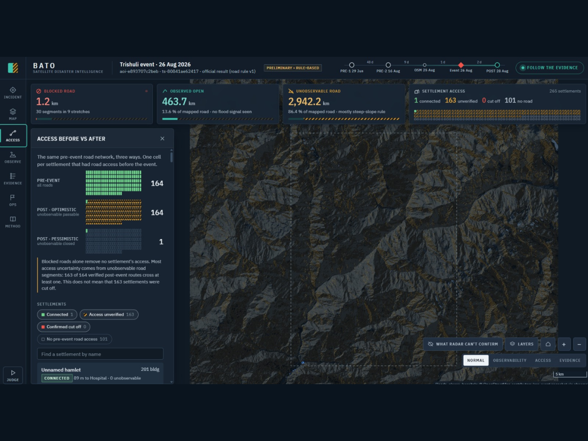
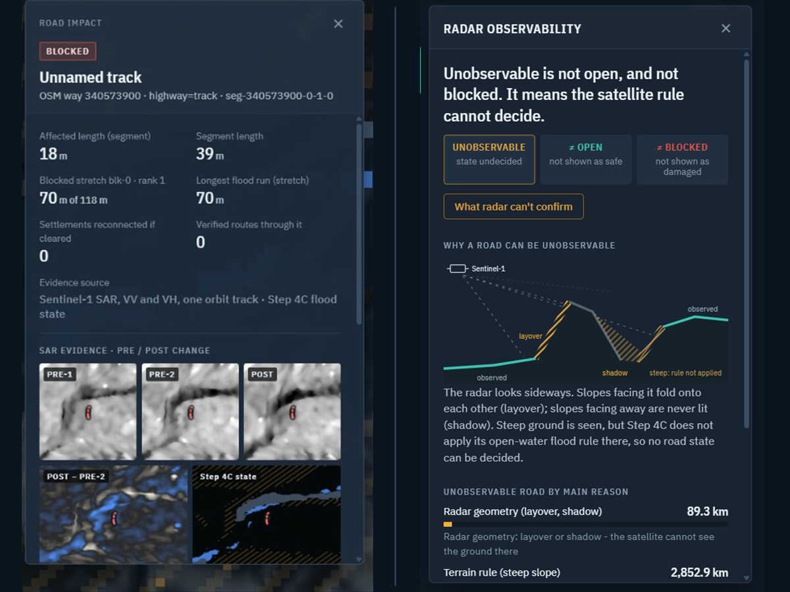

# BATO: Radar-Based Road Access Assessment After the August 2026 Trishuli Flood

**Multimodal AI Hackathon 2026 — Track B: Mapping Flood Damage from Space**
Team: 404 Competition Not Found · Authors: Mandeep Kumar Roshan, Anish Rana, Prabhnoor Singh, Arshbir Singh · Repository: https://github.com/Mandeep2807/bato-flood-access · Date: October 2026

## Executive Summary

BATO (Nepali for "road") uses Sentinel-1 radar and pre-event OpenStreetMap (OSM) to answer one question after a mountain flood: which roads show flood evidence, and which settlements may have lost road access? Where the satellite cannot tell, BATO says "unknown", never "no damage".

The official result for the Trishuli valley, Nepal (event 2026-08-26) combines a deterministic SAR change rule for flood, a road rule, a three-graph analysis of settlement access and an offline dashboard in which every number traces back to hash-verified evidence. 91.2 % of the scene could not be assessed, mostly because of steep slopes, so 2,942 of 3,407 road-km are unobservable. BATO finds 30 blocked road segments (1.2 km), confirms 1 settlement as connected and none as cut off; 163 of 265 settlements have access that remains unverified. As evaluation only, we compared the result with Copernicus EMS activation EMSR927 under a protocol frozen before any metric was computed. Both matched BATO-blocked segments were graded *Destroyed* there, but BATO missed most reference-damaged roads (matched-domain recall 0.018 on observed segments). Flood metrics are not calculable, because EMSR927 has no flood class. Thresholds are provisional and the system is not validated.

## 1. Operational Problem

In Himalayan valleys, floods and debris flows harm people mostly by cutting roads. Responders need to know which roads are affected and which villages can still reach a hospital or the road network outside the valley.

Monsoon cloud can block optical imagery for weeks. Radar sees through cloud, but in narrow valleys slopes, layover and shadow hide much of the valley floor, which is exactly where the roads run.

We therefore made our main output an access state that carries its own uncertainty, rather than a flood map. A flood map that calls unseen terrain "dry" implies that unobserved roads are passable. BATO keeps three road answers apart (**blocked**: flood evidence on the road; **observed open**: no flood evidence on a road the radar could see; **unobservable**: the radar could not assess the road), and the same distinction reaches every settlement.

## 2. Architecture

BATO is a one-directional pipeline of typed stages (Figure 1): raw data → preprocessing → detection → road impact → connectivity → evidence → presentation. Run-time guards admit only Sentinel-1, Copernicus DEM and pre-event OSM as production inputs, and pipeline code cannot import the evaluation package. The dashboard is read-only: it recomputes its summary from the published files and refuses to build if anything disagrees.

**Figure 1.** BATO architecture. Top: the official pipeline. Grey: experiments that were not adopted. Bottom: the evaluation path, which reads the official outputs and never feeds back into the pipeline.

Two components were built but are not part of the result. **FloodViT** (a Kuro Siwo checkpoint) put 64 % of its flood pixels on slopes ≥ 30° in our scene and was trained on lowland floods, so it remains a preliminary comparison layer. **The SAR disturbance (debris) detector and road rule v2** were rejected: the detector failed pre-registered criterion (d), "no edge concentration", on a matched no-event control scene. There, 23.4 % of its detections lay in the 100-pixel border band, which holds only 6.1 % of the assessed pixels. We did not re-tune it, and BATO makes no debris claim.

## 3. Data and Processing

**Sentinel-1 selection.** BATO searches the Copernicus Data Space catalogue for IW GRDH VV+VH scenes, from 60 days before the event to 24 days after. It keeps a same-track set, because different tracks are never compared pixel by pixel. For Trishuli the set is Sentinel-1D, ascending, relative orbit 85: PRE-1 on 29 June, PRE-2 on 16 August and POST on 28 August 2026 at 12:21:41 UTC.

**Preprocessing.** ESA SNAP calibrates each pass, applies a Lee Sigma speckle filter and terrain-corrects it to EPSG:3857 at 10 m with Copernicus GLO-30. The passes are stacked into six bands (three dates × VV/VH) with a validity mask. These are Kuro Siwo's settings, except that we use GLO-30 instead of SRTM, which the rules do not allow. **OSM** is an ohsome API snapshot from one day before the event; the extract is refused if any feature version postdates it. Every stage records the SHA-256 of its inputs and outputs and a configuration fingerprint.

## 4. Flood Detection (Step 4C)

Step 4C is a transparent rule, not a trained model. A pixel is FLOOD when all four conditions hold:

1. POST is open-water dark: VV ≤ −15 dB and VH ≤ −22 dB.
2. POST darkened by at least 3 dB against **both** pre-event images, in both polarisations.
3. The pixel was not already dark before the event. If it was, it becomes PRE_EVENT_WATER instead.
4. The pixel lies in a cluster of at least 10 pixels.

Before the rule, gates set pixels to NOT_ASSESSED for invalid SAR, no DEM, approximate layover, shadow (including shadow cast by ridges) and slope ≥ 15°. A dark pixel on a steep slope says more about geometry than about water. Every threshold is provisional and documented; none was tuned on a reference map, and the provenance records `validated: false`.

**Trishuli.** Of 45,256,776 pixels, 3,970,869 were assessed and 41,285,907 (91.2 %) were not: 35,544,186 steep, 4,713,918 layover, 1,027,803 shadow, and none for invalid SAR or missing DEM. 8,341 pixels are FLOOD, a fraction of 0.00210 of the assessed area.

<!-- Figure 2: Trishuli flood-state map (figures/fig2_flood_state.png, 1600 × 1000 px). -->

**Figure 2.** Trishuli flood-state map: Step 4C FLOOD pixels over a DEM hillshade, with not-assessed terrain hatched.

## 5. Road Impact and Connectivity

Pre-event OSM roads are cut into segments of at most 50 m; ways that share a vertex share a graph node, so a bridge creates no false junction. The Step 4C state is sampled every half pixel along each road. A sample is *flood* if a FLOOD pixel lies within 10 m, *unobservable* if its pixel is not assessed, and *observed open* otherwise; runs are joined across junctions. Under **road rule v1**, a segment is **BLOCKED** if it carries a flood run of ≥ 25 m, **UNOBSERVABLE** if it is not blocked but a 25 m run could hide a blockage, and **OPEN** otherwise. OPEN means "no flood seen", not "passable".

Three graphs are built from the pre-event network: **pre-event**, **post-optimistic** (BLOCKED removed) and **post-pessimistic** (BLOCKED and UNOBSERVABLE removed). A settlement is reachable if it connects to an anchor, a hospital or a road exit at the edge of the area. Comparing the graphs gives its access state:

| State | Reachable on | Meaning |
|---|---|---|
| NO_PRE_EVENT_ACCESS | none | No mapped road within 500 m (OSM gap, not flood) |
| CONFIRMED_CUTOFF | pre-event only | Unreachable even if all unobservable roads are passable |
| POSSIBLE_CUTOFF ("access unverified") | pre + optimistic | Reachable only if unobservable roads are passable |
| CONNECTED | all three | Reachable on observed-open roads alone |

Blocked stretches are ranked by how many settlements clearing them would reconnect. Every claim has an evidence record citing the Sentinel-1 products, the Step 4C raster hash, the OSM feature versions and the configuration fingerprint.

## 6. Trishuli Case Study

**Table 1. Official result summary** (AOI `aoi-e893707c2beb`, candidate `ts-80841ae62417`)

| Component | Result | Status |
|---|---|---|
| Step 4C flood state | 8,341 FLOOD px; 0.210 % of assessed; 91.2 % of scene not assessed | Official; provisional; `validated = false` |
| Road rule v1 | 71,852 segments: 30 blocked, 10,323 observed open, 61,499 unobservable | Official; not validated |
| Settlement access | 265: 1 connected, 163 access unverified, 0 confirmed cutoff, 101 no pre-event road | Official; not validated |
| Dashboard | Offline viewer; hashes verified, summary recomputed | Official presentation |
| FloodViT; debris detector + rule v2 | Preliminary; rejected | Not official |

**Table 2. Road and connectivity results (road rule v1)**

| Road state | Segments | km | Share of km* |
|---|---|---|---|
| BLOCKED (9 stretches) | 30 | 1.227 | 0.04 % |
| Observed open | 10,323 | 463.714 | 13.6 % |
| UNOBSERVABLE | 61,499 | 2,942.161 | 86.4 % |
| Total | 71,852 | 3,407.102 | |

| Settlement access (265) | Count | Graph | Reachable settlements |
|---|---|---|---|
| Connected | 1 | Pre-event | 164 |
| Access unverified | 163 | Post-optimistic | 164 |
| Confirmed cutoff | 0 | Post-pessimistic | 1 |
| No pre-event road access | 101 | | |

\*Share of km is our arithmetic from the published lengths.

No settlement is confirmed cut off: all 164 settlements with a pre-event road still reach an anchor if unobservable roads are passable. If those roads are treated as closed, only one keeps a verified route. The other **163 settlements have access that remains unverified**, which describes what radar could confirm, not that they are isolated. The result is driven by observability far more than by detected flooding: 86 % of road length lies in terrain that Step 4C does not assess.
<!-- Figures 3 and 4, side by side: access dashboard and evidence + observability view. -->
 

**Figure 3 (left).** Access dashboard: roads by state (red blocked, teal observed open, dashed amber unobservable), settlements by access state, network km bar. **Figure 4 (right).** Evidence + observability. Left: the evidence drawer of the top-ranked blocked stretch (PRE-1/PRE-2/POST chips, change image, Step 4C state under the road, evidence record). Right: Observability mode ("What radar can't confirm"). Building counts are labelled as a size proxy, not population.

## 7. EMSR927 Evaluation

EMSR927 is the Copernicus EMS Rapid Mapping activation for this event. We used it **only for evaluation**. It is stored under `data/reference/` and read only by the evaluation package; a leakage scan of all pipeline provenance must find zero hits before any metric is computed; and BATO files are hashed before and after each run.

We wrote the protocol `bato-emsr927-v1` before computing any metric, completed its class mapping from an inspection of the products, and froze it on 2026-10-05T08:41:38+00:00 (YAML SHA-256 `a02e49d8846a18602f1f1d46fe985eb3111b0d493d264883e237092bf4dae704`; document SHA-256 `872d66f31a8b8ec9fe89b7cbb2130604bef3e38462ecd6c7649dd361e95ee933`).

The products map the event as a *Landslide*, with graded road, bridge and building damage, and contain no flood class. **Flood precision, recall, F1 and IoU are therefore NOT CALCULABLE**, and the Landslide class is never mapped to flood. Bridges are context only. Building, facility and settlement-isolation metrics are not computed, because BATO makes no such predictions.

The **primary comparison** is BATO BLOCKED against EMSR927 road *Destroyed*, pooled across products. A segment takes a reference label when at least 25 m of it lies within 20 m of an EMS road line (precedence positive > excluded > negative); *Damaged* and *Possibly damaged* are excluded. *Observed-only* mode drops UNOBSERVABLE segments; *all-segments* mode counts them as not blocked.

**Table 3. EMSR927 primary road comparison** (matched-domain segment metrics; not network-wide recall, not "BATO accuracy")

| Mode | TP | FP | FN | TN | Precision | Recall | F1 |
|---|---|---|---|---|---|---|---|
| Observed-only | 2 | 0 | 108 | 10 | 1.0 | 0.018182 | 0.035714 |
| All-segments | 2 | 0 | 488 | 133 | 1.0 | 0.004082 | 0.00813 |

| Reference coverage | EMS positive road length 26,513.6 m; matched 23,228.9 m; unmatched 3,284.7 m; matched fraction 0.8761 |
|---|---|
| **Flood metrics** | **NOT CALCULABLE** (no flood class in EMSR927) |

BATO was highly conservative. Both blocked segments in the matched domain were graded Destroyed and none was graded undamaged, but a precision from two segments says little. Most reference-damaged segments were not flagged. Of the 490 matched Destroyed segments, 380 were UNOBSERVABLE, meaning BATO could not assess them under its visibility rules. The other 108 were observed but had no open-water signal, which is expected: a road buried by a debris flow need not look like water. About 88 % of the Destroyed road length lies in the matched domain. This is a one-event case study of agreement, not a validation.

## 8. Limitations

- **Detection.** Step 4C is not validated and its thresholds are provisional. It detects new open-water darkening only, so it misses mud, debris, landslide scars, structural damage, rough water and flooded vegetation; fresh sediment can look like water.
- **Observability.** One ascending pass leaves 91 % of the scene unassessed. Layover and shadow are approximated from a nominal incidence angle, and the 15° gate on a 30 m DEM can mark gorge floors as steep.
- **Infrastructure.** Access depends on pre-event OSM completeness; the 101 settlements without road access reflect unmapped roads, not the flood. Building counts are not population. Bridges can be "exposed", never "collapsed".
- **Time and evaluation.** One pass, two days after the event. EMS timestamps carry no time zone, so gaps are reported in both UTC and Nepal time. One event of a different hazard class supports no general accuracy claim.
- **Engineering.** Multi-slice passes are not mosaicked. The connectivity script still defaults to road rule v2, so the official result must be reproduced with `--road-rule v1`.

## 9. Reproducibility and Data Governance

The README gives the full sequence: catalogue query, selection and download (`--track ASCENDING/85`) → SNAP processing and stacking → `run_baseline_detection.py` → `fetch_osm_snapshot.py` → `run_connectivity.py --road-rule v1` → `build_dashboard.py`. It needs Copernicus Data Space credentials, ESA SNAP and an `OHSOME_API_KEY` read from the environment (never written to config, provenance or logs). Outputs are published atomically and earlier ones are kept as `.superseded-*`. A repeated evaluation under the frozen protocol must reproduce the first run exactly.

Population grids, JRC water, UNOSAT or EMS products as input, post-event OSM and external flood maps are never used. Attribution: "Contains modified Copernicus Sentinel data 2026"; the Copernicus WorldDEM-30 notice; "© OpenStreetMap contributors"; and the Copernicus EMS credit. The latest full test-suite run on the actual repository gave 839 passed, 11 skipped and 0 failed.

## 10. Conclusion

BATO delivers a complete, reproducible chain from Sentinel-1 imagery to a responder-facing answer:

- **flood-change mapping** with explicit not-assessed areas;
- **road blockage assessment** on the pre-event OSM network;
- **uncertainty-aware settlement access**, which separates confirmed results from unverified ones;
- an **evidence and provenance record** behind every claim;
- an **offline operational dashboard** that needs no internet connection or tile service.

At Trishuli it located 30 blocked segments in 9 stretches, confirmed 0 settlements as cut off, and showed that 163 settlements have access that remains unverified, which tells responders where ground or aerial checks are needed. The two blocked segments that EMSR927 could check agreed with it; the same comparison shows that an open-water rule does not capture debris-flow damage.

Future work: add a descending pass to reduce unassessed terrain, develop a debris signal that passes its pre-registered control test, and validate the thresholds on independent events.

## References

1. Torres, R. et al. (2012). GMES Sentinel-1 mission. *Remote Sensing of Environment*, 120, 9–24.
2. Copernicus Data Space Ecosystem: Sentinel-1 GRD products and catalogue. https://dataspace.copernicus.eu
3. Copernicus DEM GLO-30, European Space Agency / Airbus. https://doi.org/10.5270/ESA-c5d3d65
4. ESA SNAP — Sentinel Application Platform. https://step.esa.int/main/toolboxes/snap/
5. Lee, J.-S., Wen, J.-H., Ainsworth, T. L., Chen, K.-S., Chen, A. J. (2009). Improved sigma filter for speckle filtering of SAR imagery. *IEEE Trans. Geoscience and Remote Sensing*, 47(1), 202–213.
6. OpenStreetMap contributors (ODbL). https://www.openstreetmap.org
7. HeiGIT. ohsome API v2 reference. https://docs.ohsome.org/ohsome-api/v2/reference/api.html
8. Raifer, M. et al. (2019). OSHDB: a framework for spatio-temporal analysis of OpenStreetMap history data. *Open Geospatial Data, Software and Standards*, 4, 3.
9. Copernicus Emergency Management Service — Rapid Mapping, activation EMSR927. European Union. https://rapidmapping.emergency.copernicus.eu/EMSR927
10. Bountos, N. I. et al. (2024). Kuro Siwo: 33 billion m² under the water. *NeurIPS 2024 Datasets and Benchmarks*. arXiv:2311.12056.
11. MapLibre GL JS 4.7.1. https://maplibre.org
